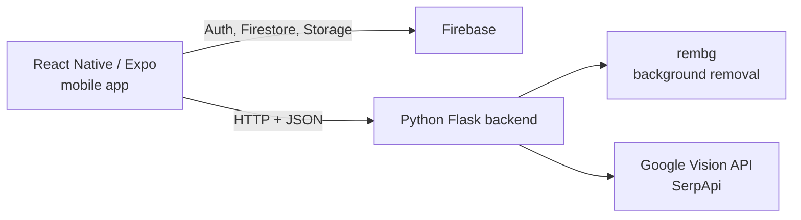

# AI-Supported Smart Digital Wardrobe Assistant

Aura is a mobile app that helps users manage their clothes digitally and get help with everyday outfit choices. Users photograph their clothes, the app removes the background, stores each item with its category and color, and suggests outfits from the user's own wardrobe.

Built as a team graduation project at Erzincan Binali Yıldırım University (Computer Engineering, June 2026).


## Features

- **Authentication:** email/password sign-up and login with Firebase Authentication
- **Add clothes:** take a photo or pick one from the gallery, then choose category, subcategory and color
- **Background removal:** clothing photos are processed by the Flask backend (`rembg`) so items look clean in the wardrobe
- **Wardrobe:** browse your items as cards and filter them by category; each user only sees their own clothes
- **Outfit suggestions:** the backend generates outfit recommendations from the items in the user's wardrobe
- **Outfit canvas:** combine pieces manually on a canvas
- **Capsule wardrobe:** mark pieces as "joker" items
- **Calendar planning:** save outfits to a date and view them again later
- **Weather information** based on the user's location
- **Visual search:** find similar products or style inspiration for a selected item (Google Vision API and SerpApi)


## Architecture

The system has three layers:



- **Mobile app** handles the screens and user interaction.
- **Firebase** handles authentication, clothing data (Cloud Firestore) and images (Firebase Storage).
- **Flask backend** handles background removal, outfit recommendation and visual search.

Clothing data is stored in a Firestore collection (`gardirop`). Each item is a document with the user ID, image URL, category, subcategory, color, timestamp and capsule/joker status.

## Tech Stack

| Layer | Technology |
|---|---|
| Mobile | React Native, Expo, JavaScript |
| Cloud | Firebase Authentication, Cloud Firestore, Firebase Storage |
| Backend | Python, Flask |
| Image processing | rembg |
| Visual search | Google Vision API, SerpApi |

## Project Structure

```
.
├── App.js               # App entry and navigation
├── AppContext.js        # Shared app state
├── firebaseConfig.js    # Firebase client configuration
├── app.py               # Flask backend
├── screens/             # Login, Register, Wardrobe, Add Photo, Outfit Suggestion,
│                        # Outfit Canvas, Calendar, Visual Search, Settings, ...
├── services/            # Service helpers
└── assets/              # Icons and splash images
```

## Getting Started

### Prerequisites

- Node.js and npm
- Python 3.9+
- A Firebase project (Authentication, Firestore and Storage enabled)
- An Android device with Expo Go, or an emulator

### 1. Firebase setup

1. Create a project in the [Firebase Console](https://console.firebase.google.com/).
2. Enable **Email/Password** sign-in, **Cloud Firestore** and **Storage**.
3. Replace the values in `firebaseConfig.js` with your own project's web app settings.
4. Set Firestore and Storage security rules so users can only access their own data.

### 2. Run the backend

```bash
python -m venv venv
venv\Scripts\activate          # Windows
# source venv/bin/activate     # macOS / Linux

pip install flask rembg        # plus the other libraries imported in app.py
python app.py
```

### 3. Run the mobile app

```bash
npm install
npx expo start
```

Scan the QR code with Expo Go. The phone and the computer running the backend must be on the **same network**, and the backend address used by the app must match your computer's local IP address.

<!-- TODO: Mention the file where the backend IP/URL is set (screens/ or services/). -->

## Testing

The project was tested through manual functional testing, organized as:

- **Unit-level checks** for each screen/module (login, register, add photo, wardrobe, outfit canvas, calendar, weather)
- **Integration tests** for the app, Firebase and the Flask backend working together
- **System tests** covering the full flow: login → add clothing → view wardrobe → get an outfit suggestion
- **Acceptance tests** from the end user's point of view

Problems found during testing included changing IP addresses, backend connection errors, Firebase read/write delays and image upload issues; all were fixed.

Automated tests are not part of this version.


Nidanur Duman
- System architecture and React Native project setup
- Firebase configuration
- Flask backend services and the outfit recommendation module
- Service integrations, data flow and wardrobe data structure
- Technical testing
- User interface layouts and screen flow
- User experience of the photo upload and wardrobe modules
- Review of the outfit canvas and calendar screens
- Test scenarios and documentation


## Future Work

- More advanced, personalized outfit recommendation algorithms
- Recommendations based on the outfits a user likes or wears often
- Context-aware suggestions using weather and events
- Publishing to the App Store and Google Play

## Academic Context

Undergraduate graduation project, Department of Computer Engineering, Faculty of Engineering and Architecture, Erzincan Binali Yıldırım University.
Supervisor: Asst. Prof. Dr. Mehmet Kürşat Öksüz. June 2026.

---

## 🇹🇷 Türkçe Özet

**Aura**, kullanıcıların kıyafetlerini dijital ortamda yönetmesini ve günlük kombin seçiminde destek almasını sağlayan bir mobil uygulamadır. Kullanıcı kıyafet fotoğrafı ekler, uygulama arka planı siler, kıyafeti kategori ve renk bilgisiyle kaydeder ve kullanıcının kendi gardırobundan kombin önerir. Ayrıca kombin tuvali, kapsül dolap (joker parça), takvim planlama, hava durumu ve görsel arama özellikleri vardır.

Mobil uygulama **React Native/Expo** ile, kullanıcı doğrulama ve veri saklama **Firebase** (Authentication, Firestore, Storage) ile, arka plan silme, kombin önerisi ve görsel arama ise **Python Flask** backend ile geliştirilmiştir.

Proje, Erzincan Binali Yıldırım Üniversitesi Bilgisayar Mühendisliği bölümünde **Nidanur Duman** ve **Elif Meva Eldut** tarafından, Dr. Öğr. Üyesi Mehmet Kürşat Öksüz danışmanlığında hazırlanan bir bitirme projesidir. Testler manuel işlevsel testlerle yapılmıştır; otomatik test bu sürümde yoktur.
